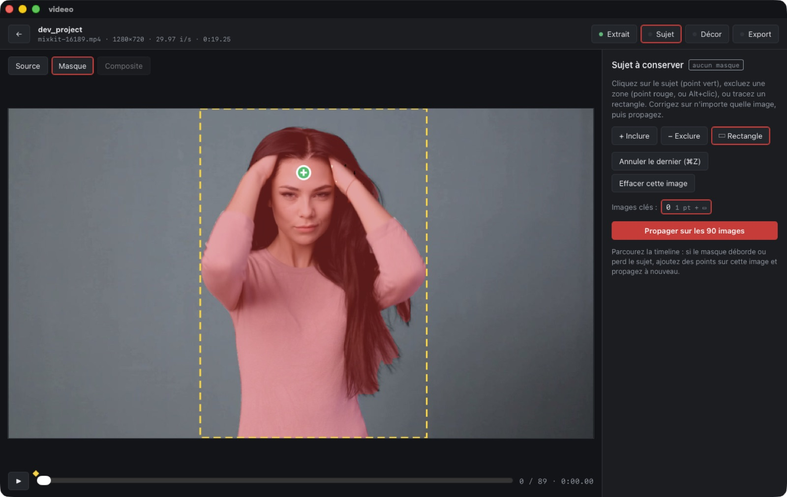
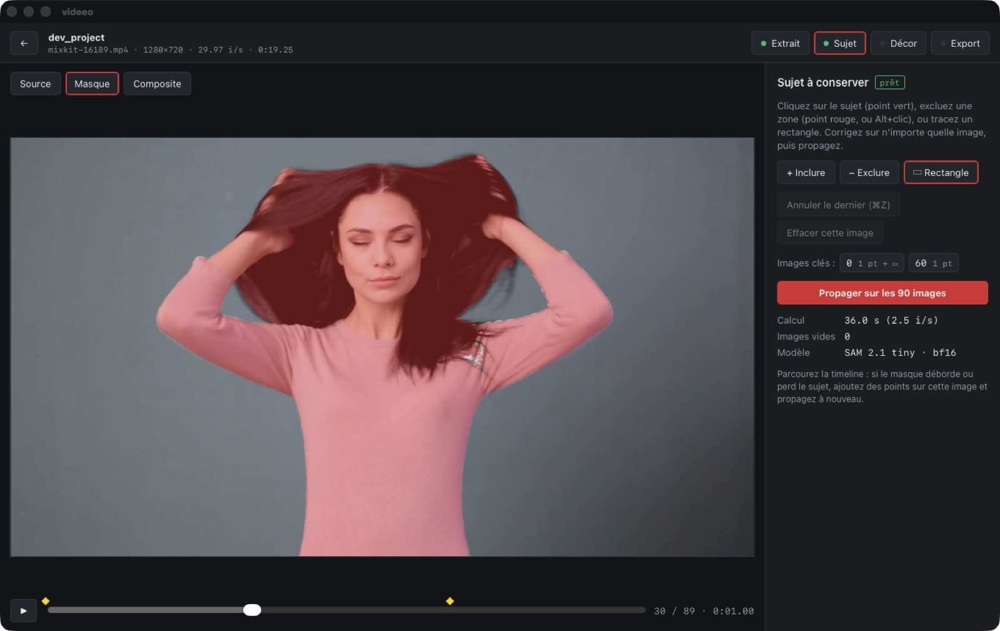
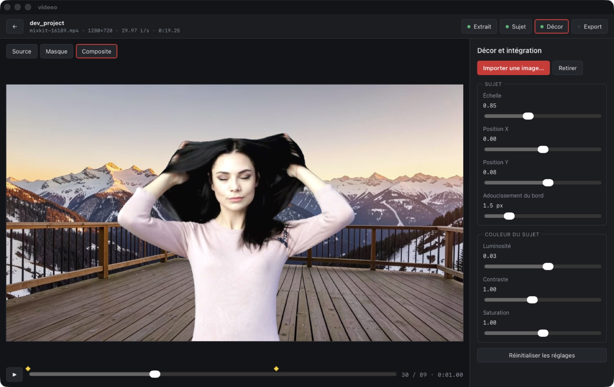
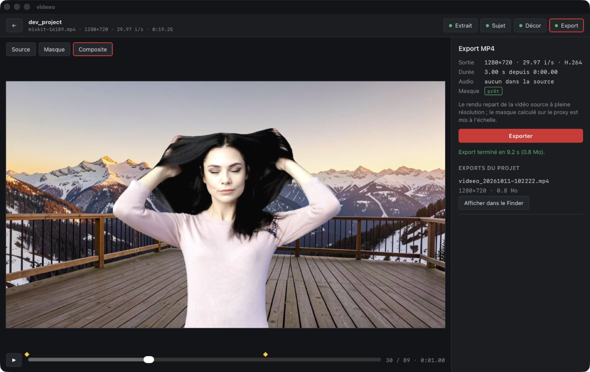

# Étape 1 — MVP manuel

**Critère du brief :** un utilisateur peut réaliser un remplacement de fond basique sans terminal.
**État :** atteint sur les clips de test. Le parcours complet a été déroulé dans l'app (scénario de démonstration ci-dessous) et vérifié par un test de bout en bout.

| 1. Sélection et aperçu du masque | 2. Masque propagé avec correction à l'image 60 |
|---|---|
|  |  |
| **3. Décor, échelle, position et couleur en direct** | **4. Export MP4 terminé** |
|  |  |

## Lancer l'app

Prérequis : les environnements de l'étape 0 (`.venvs/vision`, `models/sam2`, FFmpeg Homebrew). Voir le [README](../../README.md).

```bash
cd app
npm install
npm run tauri dev
```

L'écran d'accueil vérifie FFmpeg, le Python du worker, SAM 2 et les poids avant toute action.

## Parcours utilisateur

1. **Nouveau projet** : on choisit la vidéo (MP4/MOV), puis le nom et l'emplacement du dossier du projet. La source est référencée, jamais copiée ni modifiée.
2. **Extrait** : début et durée (120 s au maximum). Le proxy JPEG 720p est extrait à cadence constante.
3. **Sujet** : outils *Inclure*, *Exclure* (ou Alt+clic) et *Rectangle* sur n'importe quelle image. Chaque saisie lance un aperçu du masque sur cette image. ⌘Z annule le dernier point, *Propager* calcule le masque sur tout l'extrait, avec une progression annulable. Si le masque dérive, on ajoute des points sur l'image fautive et on propage à nouveau : toutes les images clés sont rejouées.
4. **Décor** : import d'une image (copiée dans `assets/`) ou couleur unie, puis échelle, position, adoucissement du bord, luminosité, contraste et saturation. L'aperçu se met à jour en direct.
5. **Export** : MP4 H.264 à la résolution de la source (rotation appliquée, 3840 px au maximum), audio AAC conservé, export atomique et vérifié par probe. Bouton *Afficher dans le Finder*.

Raccourcis : ←/→ image par image, espace lecture/pause, ⌘Z annuler.

## Architecture

```text
app/src (Vue 3 + TS)      UI, aperçu canvas (mêmes formules que FFmpeg)
   │ commandes Tauri typées + événements mask-progress / export-progress
app/src-tauri (Rust)      project.rs  manifeste versionné, clés de cache, validation
                          media.rs    ffprobe, proxy, graphe de filtres d'export
                          worker.rs   pilote JSON Lines du worker Python
                          commands.rs commandes, une tâche lourde à la fois
   │ stdin/stdout JSON Lines (schema_version 1)
workers/vision/worker.py  SAM 2.1 tiny bf16 sur MPS, écrit uniquement sous --root (le projet)
```

- **Projet** : `project.json` (schéma 1, écrit de façon atomique), `media/` (proxy), `assets/` (décors), `cache/` (masques et aperçus, régénérables), `exports/`, `logs/worker.log`.
- **Cache** : la clé du proxy dépend de la source, de l'extrait et de la hauteur ; celle du masque, du proxy, du modèle, de la précision et des invites. Changer le décor ou les réglages n'invalide pas le masque. Changer l'extrait invalide le proxy, le masque et les images clés.
- **Sécurité** : Rust valide chaque chemin (relatif au projet, sans `..`), chaque invite (dans l'image, 64 images clés et 32 points au maximum) et chaque réglage (bornes). Le worker refuse tout chemin hors du projet et toute opération inconnue. Aucun appel réseau.
- **Synchronisation proxy et export** : les deux appliquent `fps=N/D` depuis le même point d'entrée. Le masque n correspond donc à l'image n de l'export, même pour une source à cadence variable.

## Tests

```bash
cd app/src-tauri
cargo test                                   # 5 tests unitaires (manifeste, cache, validation, graphe FFmpeg)
VIDEEO_E2E_CLIP=../../clips/source/mixkit-23385.mp4 cargo test e2e -- --ignored --nocapture
```

Le test de bout en bout couvre : création du projet, proxy, worker (ping, aperçu, refus d'un chemin hors projet), propagation avec image clé de correction, export, vérification de la sortie et réouverture du projet.

**Démonstration automatique** (pour le développement, sans boîte de dialogue) :

```bash
VIDEEO_DEV_PROJECT=/tmp/demo VIDEEO_DEV_SOURCE=../clips/source/mixkit-16189.mp4 \
VIDEEO_DEV_DEMO=../stage0/results/backgrounds/mountain_terrace_1280x720.png npm run tauri dev
```

L'annulation d'une propagation a été vérifiée : arrêt en 0,35 s, et le worker reste utilisable.

## Mesures observées dans l'app (clip 16189, 3 s, 90 images, 720p)

| Étape | Temps |
|---|---|
| Extraction du proxy | < 1 s |
| Premier aperçu (démarrage Python + chargement du modèle + init vidéo) | ~3–4 s |
| Propagation, 2 images clés | 22–36 s (2,5–4 i/s)* |
| Export 1280×720 | 0,7–9 s* |

\* Ces mesures ont été prises pendant qu'un autre benchmark SAM 2 tournait sur le GPU. Seul, le worker atteint ~7,5 i/s, mesuré en isolement à l'étape 0 et au test du worker.

## Limites connues et suite (étape 2)

- **Aperçu ≠ export, pour l'adoucissement** : l'aperçu utilise un flou gaussien CSS, l'export un `boxblur`. C'est visuellement proche, mais pas identique.
- **Lecture** : la timeline lit les JPEG du proxy, sans le son. C'est suffisant pour contrôler, pas pour juger le rythme.
- **Clips longs** : au-delà de 300 images, le worker active `offload_video_to_cpu`. Le comportement sur 30–60 s est en cours de mesure (complément de l'étape 0).
- **Pas encore fait** : détection automatique de dérive, avant/après côte à côte, export rapide ou haute qualité au choix, ombre de contact, nettoyage du cache depuis l'UI, bundle `.app` signé (l'app dépend pour l'instant des venvs du dépôt).
