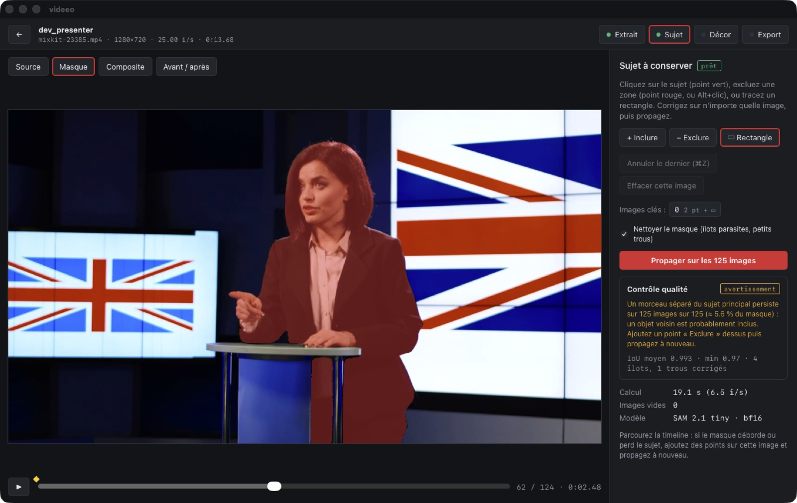
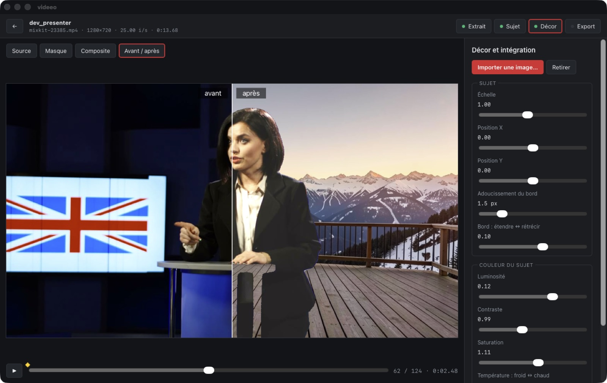
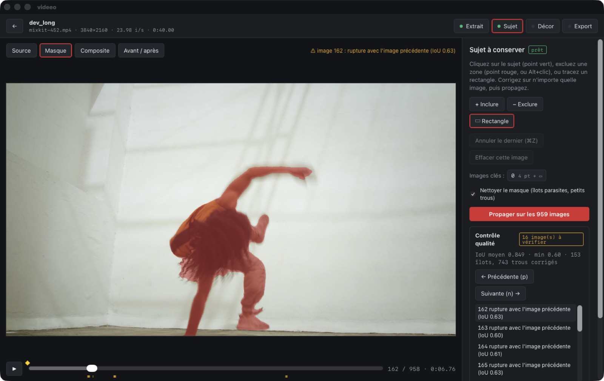
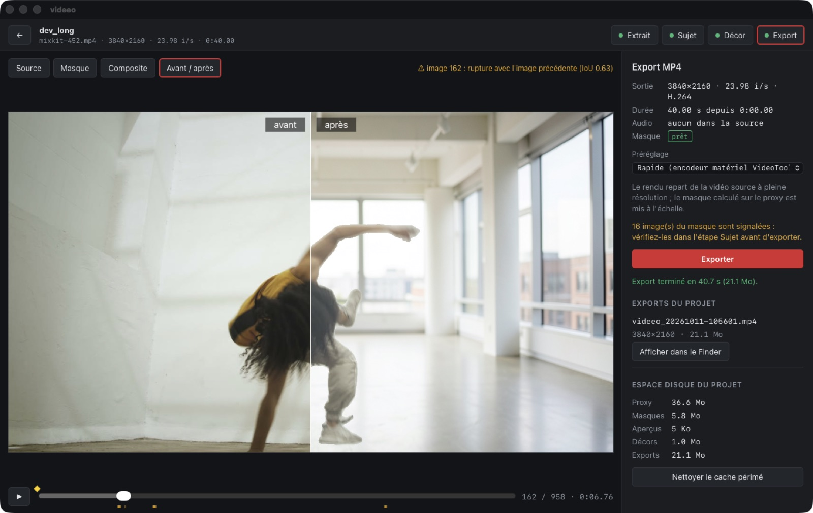

# Étape 2 — cohérence et qualité

**Objectif du brief :** propagation fiable, édition de points clés, détection de dérive ; proxy, aperçu fluide, cache, reprise/annulation ; réglages couleur et avant/après ; tests sur cheveux, mouvements rapides, occultations, fond complexe.

**État :** terminé. Tout a été vérifié dans l'app et par des tests automatisés, avec trois réserves listées en fin de document.

| Contrôle qualité : avertissement de clip (pupitre inclus) | Avant / après et harmonisation des couleurs |
|---|---|
|  |  |
| **Clip de 40 s en 4K, 959 images, traité en 3 blocs** ¹ | **Export 4K en 40 s avec VideoToolbox** |
|  |  |

¹ Cette capture date d'avant le calibrage des seuils : les 16 « ruptures » affichées sont des faux positifs dus aux mouvements rapides. Avec la règle finale, le même masque donne 0 alerte (voir § Détection de dérive).

## Ce qui a été ajouté

### Masque
- **Propagation par blocs de 400 images** (`workers/vision/worker.py`). Les blocs partagent leur image frontière. Chaque bloc est amorcé par le masque calculé dans le bloc voisin (`add_new_mask`). On propage vers l'avant depuis la première image clé, puis vers l'arrière pour les images qui la précèdent.
  - Mémoire bornée : **5,6 Go** de pic pour le worker sur le clip de 40 s (959 images), contre ~12,7 Go en un seul état (étape 0, § 9). La durée maximale d'un extrait passe de 120 à 300 s.
  - Fidélité : IoU moyen **0,995** entre blocs de 25–40 images et passe unique, vers l'avant comme vers l'arrière.
- **Reprise après interruption.** `chunks.json` mémorise les blocs terminés pour ces invites. Après une annulation, relancer reprend au premier bloc non terminé, avec un résultat **identique** au calcul ininterrompu (IoU 1,0). Dans le test, 56 images sur 120 ont été recalculées.
- **Aperçu sur une seule image.** L'aperçu ne charge plus que l'image concernée, au lieu de tout l'extrait.
- **Nettoyage du masque** (option, activée par défaut) : îlots < 5 % de la plus grande composante et trous intérieurs < 0,2 % de l'image. ~4 ms par image.
- **Détection de dérive** (`workers/vision/maskqa.py`), écrite dans `quality.json` à côté des masques :

| Critère | Règle | Pourquoi |
|---|---|---|
| Masque vide | aire = 0 | perte du sujet |
| Aire anormale | hors de [0,6 ; 1,6] × la médiane de ±7 images | effondrement ou débordement |
| Rupture | IoU < min(0,85 ; médiane − 4 MAD) **et** aire qui varie de plus de 20 % | un mouvement rapide fait chuter l'IoU sans changer l'aire |
| Saut de position | > 8 % de l'image **et** > 0,6 × la taille du sujet | changement d'objet suivi |
| Fragmentation | morceaux secondaires ou îlots retirés ≥ 1 % du masque | ignore les bouts de mèches |
| Défaut persistant | fragmentation sur plus de 50 % des images | un seul avertissement de clip, pas 125 alertes |

### Interface
- **Bande de qualité** sous la timeline, avertissement sur l'image courante, liste des images signalées, navigation avec **n** / **p**, rappel dans l'étape Export.
- **Avant / après** avec séparateur déplaçable.
- **Bord** (étendre ↔ rétrécir) et **température** (froid ↔ chaud), avec les mêmes formules dans l'aperçu (`compositor.ts`) et dans l'export (`media.rs`).
- **Harmoniser avec le décor** : rapproche d'environ un tiers la luminosité, le contraste, la saturation et la température du sujet de celles du décor, avec des bornes serrées.
- **Lecture fluide** : cadence calée sur l'horloge et préchargement des 12 images suivantes.
- **Préréglages d'export** : Rapide (VideoToolbox, repli sur x264 s'il est absent), Équilibré (x264 medium, CRF 18), Qualité (x264 slow, CRF 16).
- **Espace disque** : répartition entre éléments courants et périmés, bouton de nettoyage. Les sources, décors et exports ne sont jamais touchés.
- Proxy JPEG en qualité 3 au lieu de 2 (~30 % plus léger).

### Projet
- **Schéma 2**, avec une migration testée depuis le schéma 1 : nettoyage, bord, température, préréglage d'export. Un masque v1 devient « à recalculer », car la clé de cache intègre désormais le nettoyage.

## Banc qualité (`stage2/scripts/quality_bench.py`)

SAM 2.1 tiny bf16, 5 s par clip, invites de `stage0/clips.json`, mesuré sans autre charge GPU.

| Clip (cas du brief) | Images | IoU moy. / min | Signalées (brut / nettoyé) | Avertissement de clip | Îlots / trous corrigés | Vitesse |
|---|---|---|---|---|---|---|
| A — présentatrice (1) | 125 | 0,993 / 0,97 | 0 / 0 | **pupitre inclus (5,6 % du masque)** | 6 / 2 | 5,6 i/s |
| B — gestes, bureau encombré (2) | 125 | 0,985 / 0,95 | 0 / 0 | — | 17 / 27 | 5,5 i/s |
| C — marche, occultation (2) | 120 | 0,929 / 0,84 | 0 / 0 | — | 11 / 72 | 5,4 i/s |
| D — cheveux longs (3) | 150 | 0,957 / 0,80 | 0 / 0 | — | 265 / 584 | 5,4 i/s |
| E — selfie, caméra mobile (4) | 120 | 0,973 / 0,94 | 0 / 0 | — | 17 / 238 | 5,4 i/s |
| L — breakdance 40 s 4K (dans l'app) | 959 | 0,849 / 0,60 | 0 | — | 153 / 743 | 4,3 i/s |

**Témoin positif** : une image clé volontairement mauvaise, un seul point sans rectangle à l'image 37 du clip A. Le masque se fragmente puis s'effondre à l'image 29. Résultat : un avertissement de clip et les images **28–29 signalées** (aire ×1,8 puis ×0,16).

**Calibrage.** La première version des règles produisait des faux positifs :
- 37 images sur les cheveux, à cause de bouts de mèches comptés comme îlots ;
- 16 images sur la danse, où l'IoU est bas parce que le mouvement est rapide ;
- 125 images sur le pupitre, un défaut persistant répété image par image.

Chaque cas a été vérifié visuellement (planches générées par le banc), puis la règle a été corrigée et couverte par un test (`workers/vision/test_maskqa.py`, 8 tests). `stage2/scripts/requalify.py` recalcule la détection sur des masques existants sans relancer SAM 2.

**Vitesse.** 5,4–5,6 i/s, nettoyage, écriture PNG et contrôle qualité compris, contre 6,3–7,5 i/s pour la propagation seule à l'étape 0. Dans l'app, le clip long tourne à 4,3 i/s : les blocs de plus de 150 images gardent les images en RAM CPU.

## Tests

```bash
.venvs/vision/bin/python -m pytest workers/vision -q                     # 8 tests : nettoyage et détection
cd app/src-tauri && cargo test                                           # 6 tests : manifeste, migration v1→v2, graphe FFmpeg
VIDEEO_E2E_CLIP=../../clips/source/mixkit-23385.mp4 cargo test e2e -- --ignored --nocapture
.venvs/vision/bin/python stage2/scripts/quality_bench.py                 # banc qualité
```

Démonstrations dans l'app : fichiers `app/dev/demo_*.json`, lancés via `VIDEEO_DEV_DEMO`. Voir [docs/stage1](../stage1/README.md).

## Limites connues

- **Les images clés n'agissent que vers l'aval.** Dans un clip découpé en blocs, une correction ajoutée à l'image 800 ne modifie pas les blocs déjà calculés avant elle. Elle s'applique à son bloc et aux suivants. Sur un extrait de moins de 400 images, il n'y a qu'un bloc et ce problème ne se pose pas.
- **Harmonisation globale.** Elle compare le sujet à la moyenne du décor entier, pas à la lumière locale autour du sujet. C'est un point de départ à affiner à la main.
- **Fluidité de l'aperçu non mesurée** en images par seconde. Le composite est calculé sur le CPU, image par image (~1280×720).
- **Toujours pas de vrai fichier iPhone** (HEVC, HDR, VFR, audio, rotation réelle). L'outil le gère en théorie, mais ce n'est pas vérifié.
