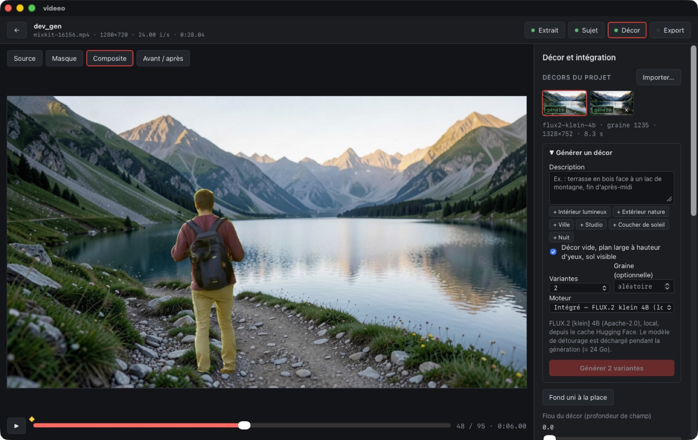

# Étape 3 — création assistée

**Objectif du brief :** génération ou import de décors ; intégration de ComfyUI via un adaptateur versionné ; préréglages de cadrage et d'éclairage ; profondeur seulement si elle améliore les cas testés.

**État :**
- Génération locale de décors : terminée.
- Adaptateur ComfyUI : terminé et vérifié sur le serveur ComfyUI de ce Mac.
- Workflow FLUX.2 pour ComfyUI : prêt, mais **non exécuté**, car les poids au format ComfyUI ne sont pas installés.
- Préréglages : terminés.
- Profondeur : écartée, avec justification (§ Profondeur).



*Clip de marche (mixkit 16156) devant un décor généré en 9,7 s par FLUX.2 klein : « chemin de randonnée en montagne au bord d'un lac alpin, fin d'après-midi ». Cadrage « Tiers gauche » et lumière « Heure dorée » appliqués automatiquement. Le parcours complet a pris ~30 s : 2 variantes, cadrage, lumière, export 1280×720.*

## Décors

- **Bibliothèque par projet** (`assets/backgrounds/`). Chaque image a un fichier `.json` à côté. Un décor généré y garde de quoi être reproduit : moteur, modèle, dépôt, licence, prompt, graine, taille, étapes et, pour ComfyUI, l'id et la version du workflow, ainsi que son statut « testé ». Les décors importés aux étapes 1–2 restent listés.
- **Import** : copie dans le projet ; l'original n'est jamais modifié.
- **Génération** : 1 à 4 variantes à graines successives, ou graine imposée. La taille suit le format de la sortie (~1 mégapixel, multiples de 16 : 1328×752 en 16:9, 752×1328 en vertical). Suggestions de style à ajouter au prompt. Option « Décor vide, plan large à hauteur d'yeux, sol visible » (activée par défaut), pour obtenir une plaque utilisable derrière un sujet filmé.
- **Annulation** immédiate, en < 0,1 s après la demande.
- **Un seul modèle lourd en mémoire.** Démarrer la génération arrête le worker de détourage (SAM 2), et inversement. Avant un appel à ComfyUI, les deux workers sont arrêtés, car ComfyUI charge ses propres modèles.

### Moteurs

| Moteur | État | Détail |
|---|---|---|
| **Intégré** (`workers/image/worker.py`) | ✅ utilisé dans l'app | FLUX.2 [klein] 4B, Apache-2.0, chargé hors ligne depuis le cache Hugging Face (aucun téléchargement). Chargement 8 s, 1328×752 en 4 étapes ≈ 8–10 s. Pic ≈ 24 Go. |
| **ComfyUI** (`app/src-tauri/src/comfy.rs`) | ✅ adaptateur vérifié · ⏳ workflow FLUX.2 non exécuté | Workflows versionnés dans [`workflows/comfyui/`](../../workflows/comfyui/README.md). |

### Adaptateur ComfyUI

- Il exécute les workflows au format API, versionnés en `<id>.v<version>.json`, en substituant les paramètres déclarés (prompt, taille, étapes, graine).
- Il soumet via `/prompt`, suit via `/history`, récupère l'image via `/view` et peut interrompre via `/interrupt`.
- **Garde-fous** :
  - serveur **local uniquement** (127.0.0.1, localhost ou [::1]) ;
  - **refus des nœuds d'API distants**. Ce ComfyUI en compte 277 (`api_node: true`), dont Flux2Pro et ComfyCloud, qui enverraient le prompt vers un service payant ;
  - vérification préalable des nœuds et des fichiers de modèles requis.
- **Test d'intégration** (`cargo test e2e_comfy -- --ignored`) contre le ComfyUI 0.34.0 de ce Mac, démarré pour l'occasion puis arrêté :
  - le workflow `solid-color` v1, sans modèle, s'exécute de bout en bout et renvoie une image 320×176 en 0,5 s ;
  - le workflow `flux2-klein-t2i` v1 est refusé **avant soumission**, avec la liste des fichiers manquants ;
  - un workflow contenant `Flux2ProImageNode` est refusé avant tout envoi.
- **Pourquoi le workflow FLUX.2 n'est pas exécuté.** ComfyUI ne charge pas les poids FLUX.2 klein au format diffusers déjà présents dans le cache Hugging Face. Il lui faut ses fichiers propres : `flux-2-klein-4b.safetensors` (modèle de diffusion), `qwen_3_4b.safetensors` (encodeur de texte) et `flux2-vae.safetensors`, soit ~16 Go qui dupliqueraient des poids déjà installés. Le moteur intégré produit le même résultat sans ce téléchargement. Les noms attendus sont à confirmer au moment de l'installation.

## Préréglages

### Cadrage

Les boutons disponibles sont : Centré, En pied au sol, Tiers gauche, Tiers droit, Plan serré.

- La boîte du sujet est la **réunion de 5 masques** répartis dans l'extrait, pour qu'un sujet qui se déplace reste dans le cadre.
- **Contrainte de coupure** : un sujet coupé par un bord de la vidéo source (une présentatrice cadrée à mi-corps, par exemple) garde ce bord hors du cadre de sortie. Sinon, la coupure apparaîtrait au milieu du décor.
- Les arrondis sont faits du côté sûr. Une première version laissait réapparaître 0,5 % de coupure ; la vérification géométrique (`npm test`, 11 cas) l'a détecté.

### Lumière

Les préréglages disponibles sont : Neutre, Heure dorée, Ciel couvert, Studio doux, Nuit, Contrasté. Ils combinent luminosité, contraste, saturation et température. « Harmoniser avec le décor » (étape 2) reste disponible.

### Décor

Le **flou du décor** simule une profondeur de champ. Il est exprimé pour une sortie 720p et mis à l'échelle de la sortie réelle ; à l'export, c'est un filtre `gblur`.

## Profondeur

Le brief demande de ne l'ajouter que si elle améliore les cas testés. Sur les 6 clips de référence, les défauts restants sont les suivants :
- la lumière qui ne correspond pas au décor ;
- l'échelle et la position du sujet ;
- les cheveux fins ;
- un objet voisin inclus dans le masque (le pupitre).

Aucun ne relève d'une estimation de profondeur monoculaire. Les deux usages possibles sont : placer le sujet derrière un élément de premier plan du décor (occlusion), et caler son échelle sur le plan du sol. Aucun des cas testés ne l'exige, et le brief rappelle qu'il s'agit d'une estimation relative, peu fiable pour les pieds. **Je ne l'ai pas ajoutée.** À réévaluer si un cas réel demande une occlusion par le décor.

## Projet

**Schéma 3**, avec une migration testée depuis le schéma 2 : flou du décor, et réglages de génération (moteur, adresse ComfyUI).

## Tests

```bash
.venvs/image/bin/python -m pytest workers/image -q        # 6 tests : validation avant chargement, chemins
cd app && npm test                                        # 11 vérifications de cadrage
cd app/src-tauri && cargo test                            # 9 tests (adaptateur ComfyUI, tailles, migration v3…)
cargo test e2e_comfy -- --ignored --nocapture             # ComfyUI local requis (http://127.0.0.1:8188)
```

Démonstration dans l'app : `app/dev/demo_generate.json`, lancée via `VIDEEO_DEV_DEMO`.

## Limites

- **Résolution du décor** : il est généré vers 1 mégapixel, puis agrandi pour une sortie 4K, où il sera visiblement plus doux. Un agrandissement dédié (SeedVR2 est présent dans ton ComfyUI) pourrait s'ajouter plus tard.
- **Perspective** : rien ne vérifie que la hauteur de caméra et la perspective du décor correspondent à celles de la prise de vue. L'option « hauteur d'yeux » oriente la génération, sans garantie.
- **Langue des prompts** : ils sont envoyés tels quels, en français, à FLUX.2 (encodeur Qwen3 multilingue). Le résultat est bon sur les essais, mais n'a pas été comparé à des prompts en anglais.
- **Contrôle de la génération** : la licence du modèle intégré est vérifiée (Apache-2.0), mais le contenu généré n'est pas filtré.
