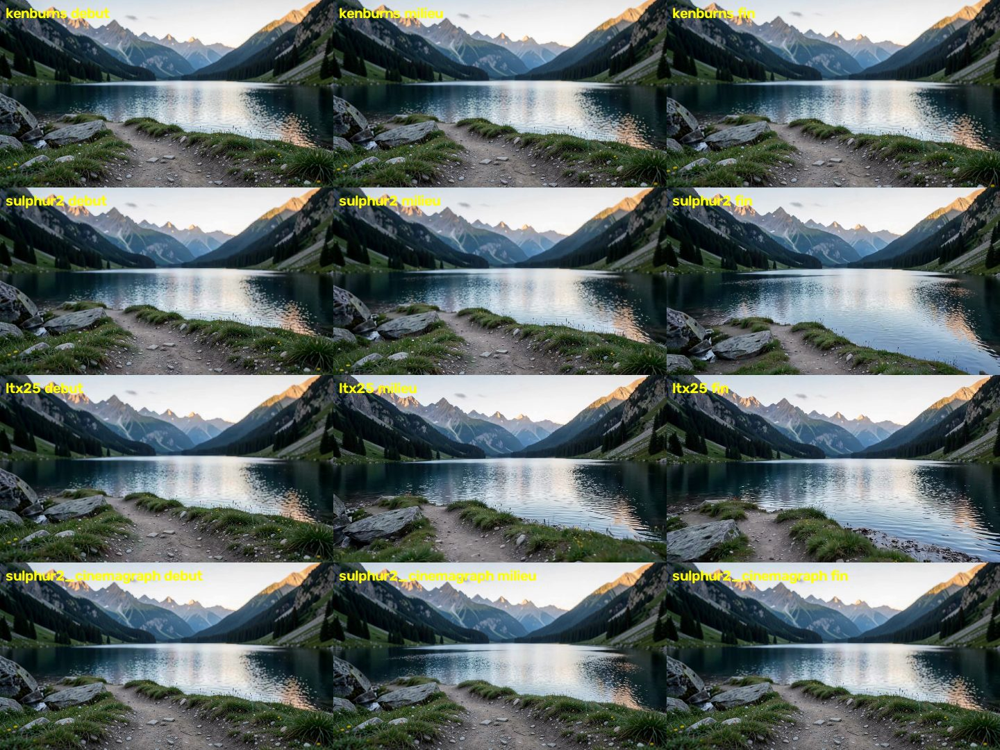
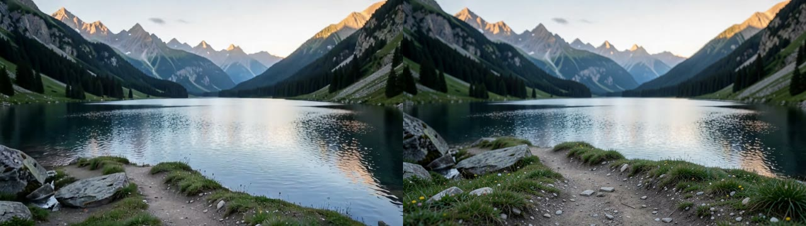
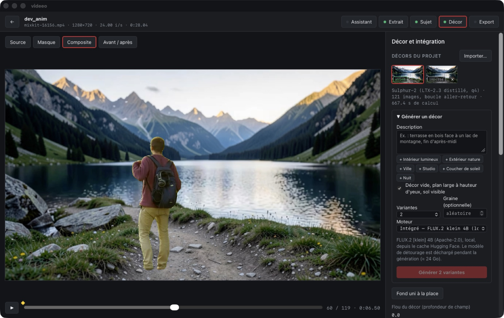

# Étape 5 — moteurs génératifs vidéo

**Objectif du brief :**
- comparer des modèles sur Apple Silicon (des GPU distants seulement sur option explicite) ;
- limiter la génération aux plans ou aux zones où le compositing ne suffit pas ;
- mesurer coût, temps, qualité, licence et stabilité avant de l'exposer comme fonction standard ;
- garder la génération vidéo complète comme capacité **expérimentale et facultative**.

**État :**
- Banc des moteurs locaux : terminé.
- Décor animé : intégré à l'app comme fonction **expérimentale**, avec un mode **cinémagraphe** recommandé par défaut.
- Wan 2.2 : retiré à ta demande, car trop lent sur Mac.
- GPU distants : non utilisés, aucun envoi hors du Mac.

## Où le compositing ne suffit pas

Dans cette app, le sujet filmé est réel. Seul le décor est remplacé. La limite du compositing, c'est donc un **décor figé** : derrière une personne qui bouge, l'eau ne coule pas et les nuages ne passent pas. L'étape 5 vise exactement ce point, et rien d'autre : animer le décor, caméra fixe.

## Banc (décor alpin de l'étape 3, 1024×576, 5 s, caméra demandée « fixe »)

Outils et commandes repris de ton guide `~/ai-video/creation_video.md`. Scripts : [stage5/scripts/](../../stage5/scripts/). Mesures : [stage5/results/clip_metrics.json](../../stage5/results/clip_metrics.json).

| Moteur | Temps (5 s) | Pic mémoire | Dérive caméra | Fidélité au décor (SSIM moy.) | Mouvement local (p95) | Scintillement | Licence |
|---|---|---|---|---|---|---|---|
| Ken Burns (ffmpeg) | **0,4 s** | 0,3 Go | 31,6 px (zoom voulu) | 0,56 | 0,54 px | 0,130 | — |
| Sulphur-2 (LTX-2.3 q4) | 437 s | **53 Go** | 10,3 px | 0,60 | 1,19 px | 0,125 | LTX-2.x Community |
| LTX-2.5 (q8, xocialize) | 521 s | 39 Go | **51,2 px** | 0,43 | 3,89 px | 0,191 | LTX-2.x Community |
| **Sulphur-2 en cinémagraphe** (lac + ciel) | 437 s + 17 s | 53 Go | **0 px** | **0,91** | 0,39 px* | **0,043** | LTX-2.x Community |
| Wan 2.2 TI2V 5B (q4) | ≈ 30 min pour **2 s** | — | — | — | — | — | Apache-2.0 |

\* Mouvement mesuré sur toute l'image ; il n'existe que dans les zones, soit 34 % de l'image.



**Constats**
- **Aucun moteur génératif ne respecte « locked camera » sur 5 s.**
  - Sulphur-2 garde la caméra presque fixe, mais réinvente le premier plan : rochers et chemin.
  - LTX-2.5 avance carrément dans la scène.
  - Or le premier plan, c'est le sol sous les pieds du sujet incrusté : s'il bouge, le montage se voit.
- **Sulphur-2** est le meilleur compromis : mouvement local réel, caméra quasi fixe, 7 à 11 min pour 5 s. Mais son pic de 53 Go sur 64 impose de décharger tout le reste, ce que fait l'app. Il produit aussi une piste audio, que l'app ignore.
- **LTX-2.5** est plus lent, plus mobile et moins fidèle : il est déconseillé pour un décor, et réservé au mode zones.
- **Wan 2.2** : à ~45 s par étape sur 40 étapes, il faut ~30 min pour 2 s de vidéo (722 s pour 49 images en 9:16 dans tes journaux). Son point fort, le vrai mouvement de caméra, est l'inverse du besoin ici. **Retiré à ta demande.** Il reste noté comme « exclu », avec la raison, dans [`workflows/video/engines.json`](../../workflows/video/engines.json).
- **Ken Burns** est instantané et jamais en échec, mais c'est un mouvement de caméra. L'app le limite à un zoom de 5 % sur la durée.

### La réponse : le cinémagraphe

On garde le décor **fixe** partout, et on n'injecte le mouvement généré que dans des **zones** désignées par un clic (eau, ciel, feuillage). SAM 2 détoure chaque zone sur l'image du décor ; c'est le même modèle que pour le sujet. Un masque adouci (`maskedmerge` de FFmpeg) fond le plan généré dans le décor fixe.

Résultat : **dérive de caméra nulle par construction**, fidélité de 0,60 à 0,91, scintillement divisé par 3. C'est exactement la consigne du brief : « limiter la génération aux zones où le compositing ne suffit pas ».



*À gauche, le plan généré entier : le lac descend jusqu'en bas, le chemin et les rochers ont disparu. À droite, le cinémagraphe : seuls le lac et le ciel bougent.*

## Dans l'app



Le panneau **Animer ce décor** (expérimental) se trouve dans l'étape Décor, sous la bibliothèque.

- **Moteur** : Sulphur-2, LTX-2.5 ou Ken Burns. Pour chacun s'affichent sa licence, ses notes de banc, le nombre d'images, la durée estimée et le pic mémoire.
- **Animer seulement des zones (cinémagraphe, recommandé)** est activé par défaut : on clique sur chaque zone sur l'image du décor, jusqu'à 8.
- **Mouvement** : le prompt reprend par défaut la formulation de ton guide (« Locked camera… motion slow and continuous »).
- **Résultat** : une **boucle aller-retour** (2N−1 images, raccord SSIM 0,994), répétée pendant tout l'extrait. Elle est rangée dans la bibliothèque, avec ses métadonnées : moteur, version, licence, prompt, graine, zones, durée de calcul.
- **Aperçu** : il lit le décor animé au temps de chaque image. L'export boucle la vidéo du décor (`-stream_loop`), et n'en garde jamais l'audio.
- **Mémoire** : avant de générer, l'app décharge SAM 2, FLUX.2 et le LLM.
- **Annulation** : elle tue le moteur. Un garde-fou le tue aussi si la tâche s'arrête anormalement, pour ne jamais laisser un processus orphelin de ~50 Go.
- **Sécurité** :
  - les moteurs sont décrits dans un registre versionné ([`workflows/video/engines.json`](../../workflows/video/engines.json)) ;
  - ils sont lancés **sans shell**, par liste d'arguments : le prompt ne peut injecter ni option ni commande ;
  - tout chemin contenant « uncensored » est refusé, suivant la consigne de ton guide.

**Vérification dans l'app** (clip de marche, décor alpin, zones lac + ciel, Sulphur-2) :
- parcours complet animation → cadrage → lumière → export réussi ;
- animation en 667 s, détourage des zones et chargement à froid compris ;
- dans l'export, la variation d'une image à l'autre vaut **3,18 sur le lac** contre **0,99 sur les rochers** du premier plan, soit le bruit de compression : le mouvement reste dans les zones.

## Bugs trouvés en testant dans l'app, corrigés et couverts par un test

1. **Plantage** : la lecture de la progression découpait le texte des barres tqdm au milieu d'un caractère « █ », ce qui faisait planter la tâche.
2. **Progression muette** : elle cherchait le dernier « / » de la ligne, qui est celui de « s/it ». Elle ne se serait donc jamais affichée.
3. **Processus orphelin** : un moteur pouvait survivre à une tâche interrompue. Un garde-fou (`KillOnDrop`) le tue désormais.

## Pourquoi cela reste expérimental

- **Coût** : 7 à 11 minutes pour 5 s, avec ~53 Go de pic. Cela ne se lance pas sans y penser.
- **Licence** : la licence LTX-2.x est gratuite sous 10 M$ de chiffre d'affaires annuel, mais l'usage commercial au-delà demande une licence payante. Elle est affichée avant chaque génération.
- **Stabilité** : elle n'est obtenue qu'en mode zones. En plan entier, le premier plan dérive sur tous les moteurs testés.
- **Bord des zones** : le plan généré peut contenir, au bord d'une zone, un détail qui ne correspond pas au décor fixe (un rivage décalé, par exemple). L'adoucissement du masque l'atténue sans le supprimer. Il faut vérifier sur l'aperçu.

## Tests

```bash
cd app/src-tauri && cargo test                  # 17 tests (dont grille d'images, graphe de boucle, progression UTF-8, refus « uncensored »)
VIDEEO_E2E_RAW=../../stage5/results/clips/sulphur2.mp4 VIDEEO_E2E_STILL=../../stage5/results/still_1024x576.png \
VIDEEO_E2E_OUT=../../stage5/results/clips/sulphur2_cinemagraph.mp4 cargo test e2e_cinemagraph -- --ignored --nocapture
stage5/scripts/video_bench.sh sulphur2          # banc d'un moteur (~7 min)
.venvs/vision/bin/python stage5/scripts/analyze_clips.py stage5/results/still_1024x576.png stage5/results/clips/*.mp4
```

Démonstration : `app/dev/demo_animate.json`, lancée via `VIDEEO_DEV_DEMO`.
