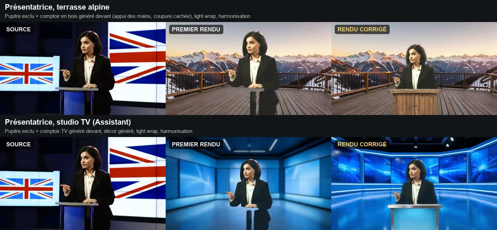

# Intégration du sujet : analyse et corrections

À partir des premiers rendus (vidéo `showcase/videeo_avant_apres.mp4`), tu as relevé trois défauts :
- les pieds du pupitre qui flottent derrière la présentatrice ;
- un corps qui s'arrête net ;
- des chevilles qui se fondent dans le sol.

Ce document explique **pourquoi**, puis ce qui a été corrigé.



## Pourquoi ce n'était pas bon

| Défaut visible | Cause réelle |
|---|---|
| Deux « poteaux » sombres sous les mains de la présentatrice | Le rectangle de sélection englobait le pupitre. Sous le plateau, le masque contient un **morceau du pupitre** (x 660–700) et le **vrai bas du corps** (x 729–870), en partie caché par le pupitre dans la vidéo d'origine. Sur un autre décor, ces deux fragments ressemblent à des poteaux, et les mains s'appuient sur un plateau qui n'existe plus. |
| Corps coupé net | Plan à mi-corps : la vidéo d'origine coupe le sujet en bas. Dans son studio, rien ne justifie cette coupure ; dans le nouveau décor, elle saute aux yeux. |
| Chevilles qui se fondent dans le sol | Les herbes passent devant les jambes dans la vidéo source. Le masque s'arrête aux tibias à certaines images, et aucune ombre ne relie le sujet au sol. |
| Aspect « autocollant » | Aucune lumière du décor ne déborde sur les bords du sujet : le contour reste celui de la prise de vue d'origine. |
| Bande sombre en bas | **Mon erreur dans la vidéo de démonstration** : la légende était posée par-dessus l'image. Elle est maintenant dans une bande au-dessus. |

Point commun : le détourage était bon. Ce qui manquait, ce sont les **outils d'intégration** que les compositeurs utilisent pour qu'un sujet appartienne au décor.

## Ce qui a été ajouté

### 1. Élément de premier plan, généré et détouré automatiquement

On décrit un objet (« comptoir en bois massif à façade pleine », « touffe d'herbes »…) :
1. FLUX.2 le génère isolé sur un fond uni ;
2. SAM 2 le détoure ;
3. l'app le recadre en PNG transparent et le range dans `assets/elements/`.

On peut aussi importer une image : un PNG déjà transparent est gardé tel quel, une photo est détourée.

Le bouton **« Placer devant le bas du sujet »** calcule la position. Le bord haut de l'élément arrive à la hauteur choisie, par exemple juste sous les mains (≈ 36 % du sujet). L'élément est au moins 10 % plus large que le sujet, et il peut déborder sous le cadre : un objet au premier plan coupé par le bord de l'image est naturel. Il ne remonte jamais au-dessus de la ligne demandée.

Deux échecs pendant les essais ont dicté ces règles :
- **Table à pieds** : on voyait les fragments du corps entre ses pieds. D'où la consigne « façade pleine fermée jusqu'au sol ».
- **Panneau vertical** : FLUX a produit un panneau plus haut que large, que le placement a agrandi au point de **cacher entièrement** la présentatrice. D'où la règle « jamais au-dessus de la ligne », couverte par 9 vérifications (`npm test`).

### 2. Points « Exclure »

Deux points d'exclusion, posés sur le pupitre, nettoient le masque. Comme le bas du corps est réellement incomplet dans la vidéo d'origine, c'est l'élément de premier plan qui règle vraiment le problème.

### 3. Ombre de contact

Elle est calculée **image par image** à partir du masque : une ellipse adoucie sous l'empreinte des pieds, qui suit la marche. Elle n'est produite **que si les pieds sont visibles**, c'est-à-dire si le masque ne touche pas le bas de l'image ; sinon il n'y a pas de sol déterminable. C'est la règle du brief. Résultat : 88 images sur 120 pour le randonneur, 0 pour la présentatrice. L'ombre suit exactement la transformation du sujet (échelle, position).

### 4. Light wrap

La lumière floutée du décor déborde légèrement sur une bande de bord du sujet. La bande vaut masque × (1 − flou du masque) ; le mélange se fait vers le décor flouté. L'aperçu et l'export utilisent les mêmes constantes (`WRAP_*_720` dans `media.rs` et `compositor.ts`).

### Ordre de composition (identique dans l'aperçu et l'export)

```text
décor (flou éventuel) → ombre de contact → sujet → light wrap → élément de premier plan
```

Le graphe FFmpeg n'ajoute chaque étape que si elle est activée. Il a été vérifié par un test qui contrôle les indices d'entrée et les filtres, puis par un export réel avec les trois effets (3,5 s pour 5 s en 720p).

## Résultat

Vidéo de démonstration : [`showcase/videeo_avant_apres_v2.mp4`](../../showcase/videeo_avant_apres_v2.mp4), en trois colonnes (source, premier rendu, rendu corrigé). La construire : `.venvs/vision/bin/python showcase/make_showcase.py`.

| Exemple | Ce qui change, visiblement |
|---|---|
| Présentatrice, terrasse alpine | Comptoir en bois de chalet devant elle : appui des mains, plus de pieds de pupitre flottants, coupure du corps cachée. |
| Présentatrice, studio TV | Comptoir de plateau TV en verre bleu : même correction, cohérente avec le décor généré. |
| Randonneur, lac animé | Ombre de contact sous les pieds et bords adoucis par le light wrap. L'amélioration est **subtile** à cette taille ; le premier rendu était déjà le plus réussi. |

Coût : la génération et le détourage d'un élément prennent ~15–20 s (FLUX.2 puis SAM 2) ; l'ombre de contact ~2 s pour 120 images.

## Ce qui reste perfectible

- **Lumière du sujet** : la présentatrice garde la lumière de studio de la prise de vue. Harmonisation et light wrap rapprochent les tons sans refaire l'éclairage, ce que ferait un relighting génératif.
- **Perspective de l'élément généré** : FLUX produit une vue de face à hauteur d'yeux. Si la caméra du décor est plus haute ou plus basse, le comptoir peut paraître légèrement « collé ».
- **Qualité variable de l'élément** : FLUX ne suit pas toujours la description (le panneau vertical, par exemple). On régénère avec une autre graine, ou on importe une image.

## Projet

**Schéma 4**, avec une migration testée depuis le schéma 3 : ombre, light wrap, élément de premier plan.
